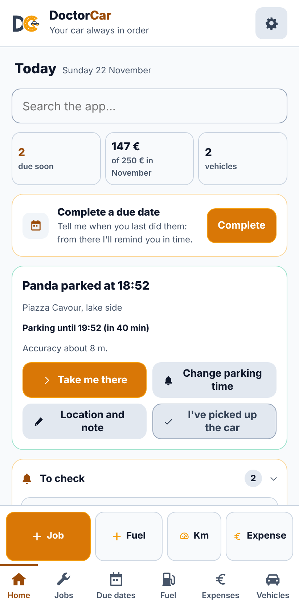
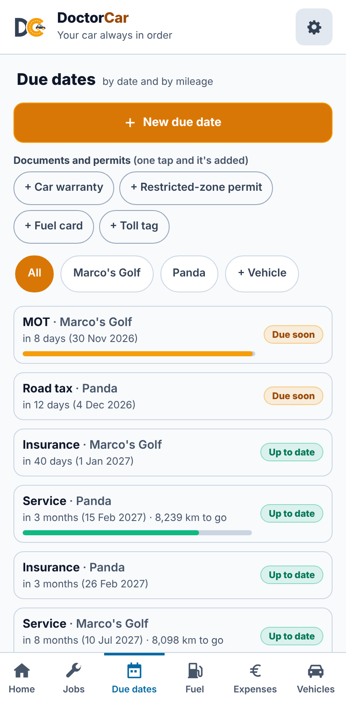
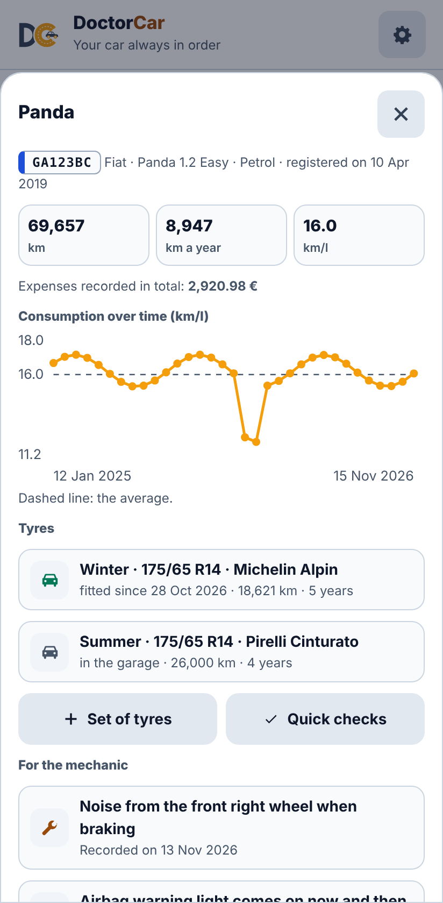

<p align="center">
  
</p>

<h1 align="center">DoctorCar</h1>
<p align="center"><b>Your car's maintenance log, even without internet.</b></p>

<p align="center">Android 10+ · v2.4.6 · English and Italian · Free and open source (GPL-3.0)</p>

---

## Install

1. Open the **[Releases](../../releases/latest)** page of this repository on your phone.
2. Download the `DoctorCar-….apk` file and open it. The first time, Android asks you to allow installs from the browser or the Files app.
3. Done. Later versions arrive by themselves: DoctorCar checks once a week for a new one (can be turned off in Settings → Updates) and Android always asks for confirmation.

It installs over the previous version without losing data. It needs **Android 10 or later**.

## What it is

DoctorCar keeps everything about your car in order: **jobs** (services and repairs), **due dates** (service, MOT/inspection, road tax, insurance…), **fill-ups** with real fuel consumption, and **expenses**. It works **offline**: your data stays on your device, with no account and no cloud.

The same code comes in two forms: a single-file **web page** to open on a computer, and an **Android app** that can **sync** data between several phones and tablets with **PairWood**, directly over your home Wi‑Fi.

<p align="center">
  
  &nbsp;
  
  &nbsp;
  
</p>

## What it's good for

- **Never forget a due date**: inspection, road tax, insurance, service, driving licence, toll tag, restricted-zone permit. DoctorCar reminds you in time and knows the Italian rules (inspection valid to the end of the month, 15 days of insurance grace).
- **Know what your car really costs**: real consumption between two fill-ups, expenses month by month, cost per kilometre, monthly budget and a 12‑month forecast.
- **Your car's whole history in your pocket**: every job with date, km, garage, cost and invoice photos; the **PDF logbook** is handy when you sell the car.
- **Families with several cars or drivers**: everyone records from their own phone, the data stays the same for everyone (without a cloud) and you can see who did what.
- **Everyday things**: where you parked and when the parking time runs out, winter and summer tyres, quick monthly checks, fines to pay with the discount.

## Features

### Vehicles
- Several cars (or motorbikes): name, make, model, number plate, fuel, first registration, km.
- **The important details straight away** when adding a car: insurance, road tax, last inspection, last service, winter tyres. Due dates are created complete.
- A card for each car with current km, km per year, average consumption, total expenses and due dates.

### Jobs
- A log with date, km, **what was done** (several items at once: service, oil, filters, brakes, tyres, timing belt, battery, inspection, road tax…), garage, cost, notes.
- **List for the mechanic**: a noise, a warning light? Note it on the car's card and it goes on the sheet for the garage.
- **Spare parts in the garage**: oil, bulbs, washer fluid… for each car, with − and + to count them; «To buy again» when running low.

### Due dates
- By **date** and by **kilometres**, «whichever comes first».
- They update by themselves when you record the matching job; «Done» on a due date opens the job already filled in.
- With the km updated now and then, DoctorCar **estimates the date** of km-based due dates.

### Tyres, checks, budget, quick expenses, parking
- **Tyre history** with size and DOT; km counted automatically, age from the DOT, seasonal swap.
- **Quick checks** on the 15th of each month (pressure, oil, lights, washer…).
- **Consumption chart** with abnormal fill-ups in red; **monthly budget**; **quick expense** (toll, parking, car wash, fine with the 30% discount).
- **Where I parked**, «Take me there» and **timed parking** with reminders.

### Home, search and fewer taps
- A tidy **Home**: three tiles at the top, one suggested action, «To check» in one block, then due dates, jobs and vehicles.
- **Search** across settings, features, cars, due dates and jobs.
- **Ready values** (estimated km, last garage and cost, last price per litre), «Like last time» in one tap.

### Appearance and vibration
- **Theme** automatic, light or dark (changes instantly, no flicker); **animations** on or off; **text size** Normal, Large, Very large; **screen smoothness** Automatic, Maximum (up to 120 Hz) or 60 Hz; **vibration** with strength and types.

### Fingerprint lock (Android app)
- On opening and when you return, DoctorCar asks for the **fingerprint or phone PIN**; recent apps show nothing.
- Also required to export or import a backup, export the spreadsheet and erase everything.
- The **backup** is always encrypted with a password chosen by whoever makes it (AES‑256‑GCM, key from the password with PBKDF2, 600,000 rounds).

### Due-date reminders (Android app)
- **Notifications** before service, inspection, road tax, insurance and other due dates, even with the app closed and after a restart.
- **Buttons in the notification**: «Done today» and «Remind me in a week»; on the 1st of each month «How many km?» answered right from the notification.
- **Shortcuts** on the icon and **widgets** on the Android home screen.

### Invoice photos, fill-ups and expenses
- Up to **12 photos per job**, reduced and kept on the device; with sync they travel to the other devices **encrypted**.
- **Real consumption** (km/l and l/100 km), expenses by year and month, **cost per km**, **trip cost**, export to a **CSV spreadsheet**.

### Data
- **Encrypted backup** with photos, **Merge** or **Replace** on import; **import from another app** (CSV from Fuelio, Fuelly, Drivvo, Simply Auto, aCar…); **PDF logbook** and **sheet for the garage**; weekly **automatic backup** to a folder of your choice (Android app).

### Sync (Android app)
- **Direct with PairWood**: paired devices talk on the same Wi‑Fi, over TLS 1.3, with no cloud or account; pairing with a **code or QR**.

### Languages, updates, help
- **English and Italian** (Settings → Appearance → Language): the language changes at once; «Automatic» follows the phone.
- **Updates** from GitHub once a week, with a switch: an update installs only if it has the same signature as the app and the published fingerprint.
- **Report a problem or an idea** (bottom of Settings): prepares an email to crslabs.info@gmail.com that you send yourself.

## Security and privacy
- The page **cannot connect to the internet**: CSP rule `connect-src 'none'`, only scripts with a sha256 hash, no external libraries.
- The network is used only by PairWood's native code (towards paired devices) and by the update check (one read from GitHub a week, can be turned off). None of your data leaves the device. Details in [`PRIVACY.md`](PRIVACY.md).
- Sync key and code are kept in the Android **Keystore**; `allowBackup=false`.
- All incoming data (backup, sync) is cleaned field by field; all displayed data goes through `esc()`.

## Documentation
| What | Where |
|---|---|
| User guide with screenshots (PDF) | [`guida/DoctorCar-Guide-EN.pdf`](guida/DoctorCar-Guide-EN.pdf) · Italian: [`guida/DoctorCar-Guida.pdf`](guida/DoctorCar-Guida.pdf) |
| «How to» tutorials (PDF) | [`guida/DoctorCar-Tutorials-EN.pdf`](guida/DoctorCar-Tutorials-EN.pdf) · Italian: [`guida/DoctorCar-Tutorial.pdf`](guida/DoctorCar-Tutorial.pdf) |
| Automated tests | [`prove/README.md`](prove/README.md) |
| Developer notes | [`DEVELOPMENT.md`](DEVELOPMENT.md) |
| Privacy policy | [`PRIVACY.md`](PRIVACY.md) |

## Project layout
```
sorgente-DoctorCar.html   the page (HTML, style and script in one file)
piattaforma-android.js    the Android layer (files, vibration, PairWood sync, updates)
prepara.py                CSP hashes and www/index.html for the app
android/                  Android project (Capacitor 8) + PairWood SDK in android/pairwood-sdk
icona/, genera-icone.js   symbol, icons and splash screen
prove/                    automated tests (Playwright)
guida/                    user guide and tutorials in PDF, screenshots and sample data
lingua/                   English translation (lingua/inglese.txt) and the script that puts it into the page
rilasci/                  how to publish a version, and the file used by the updater
```
The code and its comments are in Italian; folder names too (`guida` = guide, `prove` = tests, `lingua` = language, `rilasci` = releases, `icona` = icon).

## Build
```
npm install
python3 prepara.py
npx cap sync android
cd android && ./gradlew assembleRelease
```
A signed APK needs the signing key, which is **not** in this repository: without it Gradle produces an unsigned APK for your own testing. Details in [`DEVELOPMENT.md`](DEVELOPMENT.md).

## Support DoctorCar

DoctorCar is free, with no ads and no data collection. If you find it useful you can buy me a coffee: **[ko-fi.com/crslabs](https://ko-fi.com/crslabs)**.

## Contact

Problems, ideas, questions: **crslabs.info@gmail.com**, or «Report a problem or an idea» inside the app.

## Licence

© 2026 CrsLabs. DoctorCar is free software: you can use, study, modify and redistribute it under the terms of the **GNU General Public License version 3 or later** (full text in [`LICENSE`](LICENSE)). It is distributed in the hope that it will be useful, but **without any warranty**.

Third-party components: [Capacitor](https://capacitorjs.com) (MIT licence). The PairWood sync engine belongs to CrsLabs and is included here precompiled in `android/pairwood-sdk`.
