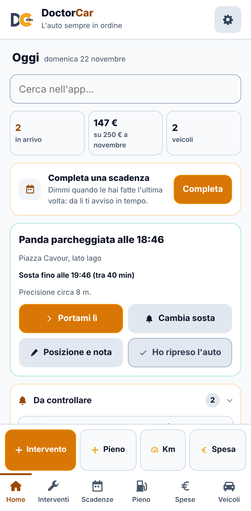
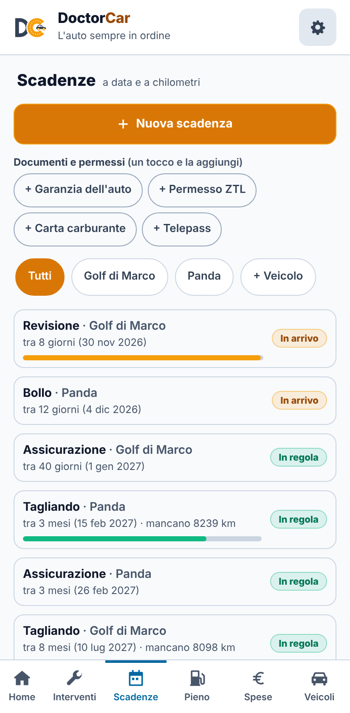
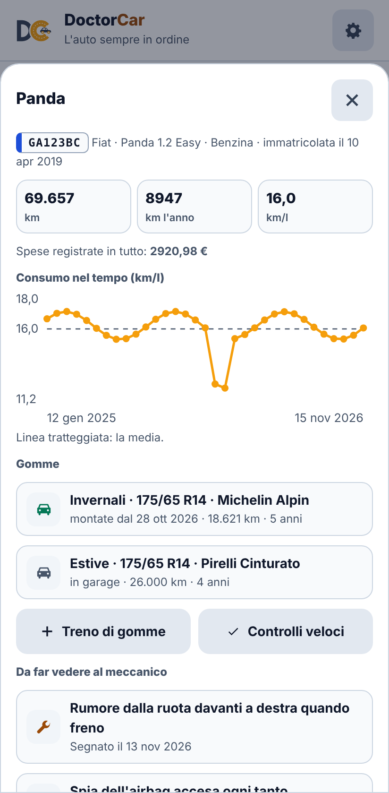
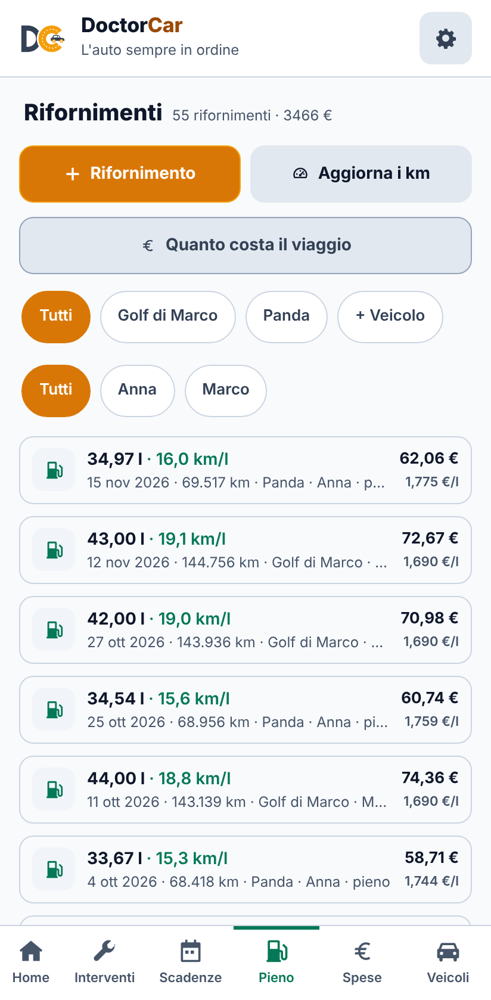
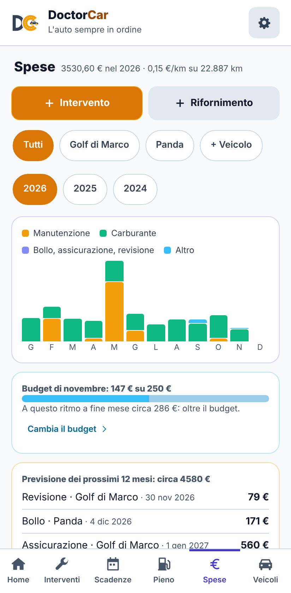
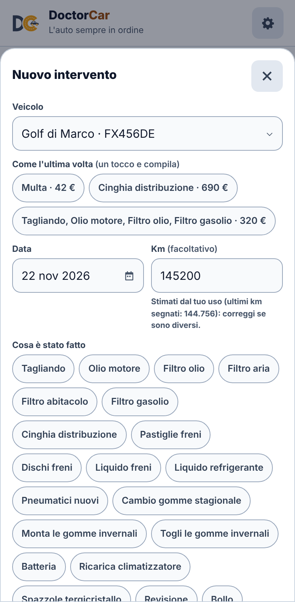

<p align="center">
  
</p>

<h1 align="center">DoctorCar</h1>
<p align="center"><b>Il libretto di manutenzione dell'auto, anche senza internet.</b></p>

<p align="center">Android 10+ · v2.4.3 · Italiano e inglese · Gratis e open source (GPL-3.0)</p>

---

## Installare

1. Apri la pagina **[Releases](../../releases/latest)** di questo repository dal telefono.
2. Scarica il file `DoctorCar-….apk` e aprilo. La prima volta Android chiede di permettere l'installazione dal browser o dall'app File.
3. Fatto. Le versioni successive arrivano da sole: DoctorCar controlla una volta a settimana se ce n'è una nuova (si può spegnere in Impostazioni → Aggiornamenti) e Android chiede sempre la conferma.

Si installa sopra la versione precedente senza perdere i dati. Serve **Android 10 o più recente**.

## Cos'è

DoctorCar tiene in ordine tutto quello che riguarda l'auto: **interventi**, **scadenze** (tagliando, revisione, bollo, assicurazione…), **rifornimenti** con i consumi e **spese**. Funziona **offline**: i dati restano sul tuo dispositivo, senza account e senza cloud.

Esiste in due forme dello stesso codice: una **pagina web** in un solo file da aprire dal PC, e un'**app Android** che può **sincronizzare** i dati tra più telefoni e tablet con **PairWood**, direttamente nella Wi‑Fi di casa.

Stesso stile di DoctorWood: blu notte e ambra, tema chiaro e scuro, finestre dal basso, movimenti morbidi.

## Per cosa è utile

- **Non dimenticare più le scadenze**: revisione, bollo, assicurazione, tagliando, patente, Telepass, permesso ZTL. DoctorCar avvisa in tempo, conosce le regole italiane (revisione a fine mese, 15 giorni di tolleranza dell'assicurazione) e così si evitano more e multe.
- **Sapere quanto costa davvero l'auto**: consumo vero fra due pieni, spese mese per mese, costo al chilometro, budget del mese e previsione dei prossimi 12 mesi.
- **Avere tutta la storia dell'auto in tasca**: ogni intervento con data, km, officina, costo e foto della fattura; il **libretto in PDF** è utile quando si vende l'auto.
- **Famiglie con più auto o più guidatori**: ognuno segna dal suo telefono, i dati restano uguali per tutti (senza cloud) e si vede chi ha fatto cosa.
- **Le piccole cose di ogni giorno**: dove ho parcheggiato e quando scade la sosta, gomme invernali ed estive, controlli veloci del mese, multe da pagare con lo sconto.

<p align="center">
  
  &nbsp;
  
  &nbsp;
  
</p>
<p align="center">
  
  &nbsp;
  
  &nbsp;
  
</p>

## Funzioni

### Veicoli
- Più auto (o moto): nome, marca, modello, targa (sempre maiuscola), alimentazione, prima immatricolazione, km.
- **Nuovo veicolo con i dati importanti subito**: assicurazione, bollo, ultima revisione, ultimo tagliando, gomme invernali. Le scadenze nascono già complete, senza secondi passaggi.
- Scheda dell'auto con km attuali, km l'anno, consumo medio, spese totali e scadenze.

### Interventi
- Registro con data, km, **cosa è stato fatto** (anche più voci insieme: tagliando, olio, filtri, freni, gomme, distribuzione, batteria, revisione, bollo…), officina, costo, note.
- Ricerca e raggruppamento per anno.
- **Lista per il meccanico**: un rumore, una spia? Lo segni subito nella scheda dell'auto e finisce nel foglio per l'officina. Dopo l'intervento DoctorCar chiede cosa è stato sistemato.
- **Ricambi in garage**: olio, lampadine, lavavetri… di ogni auto, nella sua scheda, con − e + per contarli; quando ne restano pochi compare «Da ricomprare». Dopo un intervento chiede quanti ne hai usati.

### Scadenze
- A **data** e a **chilometri**, «quello che arriva prima».
- Si aggiornano da sole quando segni l'intervento corrispondente; «Fatto» dalla scadenza apre l'intervento già compilato.
- **Revisione**: la prima 4 anni dopo l'immatricolazione, poi ogni 2.
- Con i km aggiornati ogni tanto, DoctorCar **stima la data** delle scadenze a chilometri.
- In Home: scadute, in arrivo (entro 30 giorni o 1.000 km) e quelle da completare.

### Regole italiane e documenti
- **Bollo** proposto da solo; costi di bollo, assicurazione e revisione già nel nuovo veicolo: si paga entro la fine del mese di immatricolazione.
- **Assicurazione**: dopo la scadenza ricorda i **15 giorni di tolleranza** e avvisa l'ultimo giorno di copertura.
- **Revisione** valida fino alla **fine del mese** di scadenza.
- **Documenti e permessi** con un tocco: patente, carta carburante, Telepass (tuoi), garanzia e permesso ZTL (dell'auto). «Fatto» chiede la nuova data.

### Gomme, controlli, budget, spese veloci, parcheggio
- **Storico delle gomme**: treni estivi, invernali o 4 stagioni con misura e DOT; km contati da soli, età dal DOT, avvisi oltre i 6 anni o i km consigliati. Segnando il cambio stagionale le gomme si **scambiano da sole**.
- **Controlli veloci** il 15 di ogni mese (pressione, olio, luci, lavavetri…): «Tutto a posto» direttamente dalla notifica.
- **Grafico del consumo** nel tempo, con i pieni anomali in rosso.
- **Budget del mese** con la stima a fine mese e l'avviso se lo superi.
- **Spesa veloce** (pedaggio, parcheggio, lavaggio, multa): la **multa** non pagata diventa un promemoria entro 5 giorni con lo **sconto del 30%** già calcolato.
- **Dove ho parcheggiato**: la schermata «Dove sei» mostra indirizzo, precisione e coordinate; «Aggiorna la posizione» tiene la lettura più precisa, «Vedi sulla mappa» la controlla. Con la posizione spenta propone di accenderla, con il permesso negato di darlo. Il punto resta solo sul telefono; «Portami lì» apre le mappe, la **sosta a tempo** avvisa 10 minuti prima e alla scadenza.

### Home e ricerca
- **Home ordinata**: tre riquadri in alto (scadenze, speso nel mese, km), un'azione consigliata, «Da controllare» in un solo blocco, poi scadenze, interventi e veicoli.
- **Ricerca** nella Home: impostazioni, funzioni, auto, scadenze e interventi; il risultato porta direttamente dove serve.
- **Segnala allo sviluppatore** un problema o un'idea: il testo (con le informazioni tecniche, senza dati personali) passa alla tua app di posta.

### Meno tocchi
- **Valori già pronti**: i km stimati dal tuo uso, officina e costo dell'ultima volta, prezzo al litro dell'ultimo pieno, «Come l'ultima volta» in un tocco.
- **Rifornimento**: scrivi due fra litri, prezzo e importo, il terzo si calcola.
- **Un'azione consigliata** in Home, con un solo tasto.
- La barra «+ Intervento / + Rifornimento / Km» sta solo in Home; ogni sezione ha il suo tasto per aggiungere da lì.
- Menu coerenti con il resto dell'app (non più quelli di Android) e tastiera che suggerisce e corregge.
- **Avvisi in Home** quando qualcosa non torna: km più bassi di prima, consumo anomalo, nessun rifornimento da tempo, copia di sicurezza vecchia.
- **Previsione delle spese** dei prossimi 12 mesi (scadenze con il costo dell'ultima volta + carburante).
- **«Chi»**: con più persone sugli stessi dati, ogni intervento e rifornimento ricorda chi l'ha segnato e si filtra.

### Aspetto e vibrazione (come DoctorWood)
- **Apertura con il logo** (app Android): il logo nasce dal centro in dissolvenza, poi il nome; quindi la schermata sfuma e la Home entra, un riquadro dopo l'altro.
- **Tema** automatico, chiaro o scuro; **animazioni** accendibili e spegnibili.
- **Dimensione del testo**: Normale, Grande, Molto grande. Nell'app è lo zoom del testo di Android (cresce solo il testo, l'impaginazione va a capo).
- **Fluidità dello schermo**: Automatica, Massima (fino a 120 Hz, dove lo schermo lo permette) o 60 Hz per risparmiare batteria.
- **Vibrazione** brevi e secche: intensità a scelta (Leggera, Normale, Forte, con uno slider che si sente subito) e tre tipi che si accendono uno per uno: tasti e scelte, operazioni riuscite, avvisi.

### Accesso con l'impronta (app Android)
- All'apertura e quando torni nell'app, DoctorCar chiede **impronta o PIN del telefono**: finché non confermi la pagina resta coperta e nelle app recenti non si vede niente.
- Non chiede niente se esci perché lo ha chiesto l'app (fotocamera, scelta di una foto o di un file, «Salva come», permessi), a meno di restare fuori più di 10 minuti.
- Impronta o PIN servono anche per **esportare o importare una copia di sicurezza**, per esportare la tabella e per **cancellare tutto**.
- Da Impostazioni → Sicurezza si può spegnere (serve l'impronta). Se il telefono non ha né impronta né PIN, l'app si apre senza chiedere niente.
- La **copia di sicurezza** è sempre cifrata con la password scelta da chi la fa (AES‑256‑GCM, chiave dalla password con PBKDF2 600.000 giri): senza la password il file non si apre.

### Avvisi sulle scadenze (app Android)
- **Notifiche** prima di tagliando, revisione, bollo, assicurazione e delle altre scadenze, anche con l'app chiusa e dopo il riavvio del telefono.
- Il primo avviso a scelta (30, 14 o 7 giorni prima), poi il giorno prima e il giorno stesso, all'ora che preferisci. Se la scadenza è passata, un promemoria a settimana per tre settimane.
- Per le scadenze a chilometri l'avviso segue la data stimata dal tuo uso dell'auto.
- **Tasti nella notifica**: «Fatto oggi» (registra l'intervento) e «Rimanda di una settimana»; il primo di ogni mese «Quanti km ha l'auto?» con risposta direttamente dalla notifica.
- **Scorciatoie dell'icona** (tieni premuto) e **widget** nella Home di Android: prossima scadenza e tasti per rifornimento, km, intervento.
- «Aggiungi al calendario» da ogni scadenza.
- Si chiede una sola volta se si vogliono; da Impostazioni → Avvisi si cambiano o si spengono.

### Foto delle fatture
- Fino a **12 foto per intervento**: fattura, scontrino, preventivo dell'officina. Si scattano con la fotocamera o si scelgono dalla galleria.
- Vengono ridotte (lato lungo 1600 px) e restano sul dispositivo; con la sincronizzazione viaggiano sugli altri dispositivi abbinati, **cifrate**.
- Visore a schermo intero con zoom; nell'elenco degli interventi si vede quante foto ha ognuno.
- Entrano anche nella **copia di sicurezza** cifrata.

### Rifornimenti e spese
- Rifornimenti con quantità (litri, kWh o kg), importo e «pieno»: **consumo vero** fra due pieni (km/l e l/100 km) e prezzo medio.
- Spese per anno e per mese (manutenzione, carburante, bollo/assicurazione/revisione, altro) e **€/km**.
- **Quanto costa il viaggio**: scrivi i km (e se vuoi persone e pedaggi) e calcola carburante, totale e costo a testa con il consumo vero della tua auto.
- Esportazione in **tabella CSV** (Excel, Fogli).

### Dati
- **Copia di sicurezza cifrata** (AES‑256‑GCM, PBKDF2‑SHA‑256 600.000) con le foto, da esportare e reimportare con **Unisci** o **Sostituisci** (le copie della versione 1.0 si importano ancora).
- «Cancella tutto da questo dispositivo».

### Dati: altre funzioni
- **Importa da un'altra app** (CSV di Fuelio, Fuelly, Drivvo, Simply Auto, aCar e simili): colonne riconosciute da sole, nessun doppione.
- **Libretto in PDF** di ogni veicolo (condividi o salva; sul computer si stampa) e **foglio per l'officina** da condividere.
- **Copia automatica** (app Android): una copia cifrata a settimana in una cartella a scelta (anche su Drive), ultime 5 tenute; la password si scrive una volta e resta nel Keystore.

### Sincronizzazione (app Android)
- **Diretta con PairWood**: i dispositivi abbinati si parlano nella stessa Wi‑Fi, in TLS 1.3, senza cloud né account.
- Abbinamento con **codice o QR**; con tre o più dispositivi basta abbinarne uno (gli altri li presenta PairWood).
- Ogni dispositivo scrive solo il proprio file cifrato; i dati si uniscono record per record (vince la modifica più recente, anche le cancellazioni). Le foto viaggiano come file cifrati a parte.
- Elenco dei dispositivi abbinati, «Dimentica», «Scollega».

### Lingue, aggiornamenti, aiuto
- **Italiano e inglese** (Impostazioni → Aspetto → Lingua): la lingua cambia subito; «Automatica» segue il telefono.
- **Aggiornamenti** da GitHub una volta a settimana, con interruttore: l'aggiornamento si installa solo se ha la stessa firma dell'app e la stessa impronta pubblicata.
- **Segnala un problema o un'idea** (in fondo alle Impostazioni): prepara una mail a crslabs.info@gmail.com che spedisci tu.

## Sicurezza e privacy
- La pagina **non può collegarsi a internet**: regola CSP `connect-src 'none'`, solo script con impronta sha256, nessuna libreria esterna.
- La rete la usano solo il codice nativo di PairWood (verso i dispositivi abbinati) e il controllo degli aggiornamenti (una lettura da GitHub a settimana, si può spegnere). Nessun dato tuo esce dal dispositivo. Dettagli in [`PRIVACY.md`](PRIVACY.md).
- Chiave e codice della sincronizzazione custoditi con il **Keystore** di Android; `allowBackup=false`.
- Ogni dato in entrata (copia, sincronizzazione) viene ripulito campo per campo; ogni dato mostrato passa da `esc()`.

## Documentazione
| Cosa | Dove |
|---|---|
| Guida all'uso con immagini (PDF) | [`guida/DoctorCar-Guida.pdf`](guida/DoctorCar-Guida.pdf) |
| Tutorial «come si fa» per ogni funzione (PDF) | [`guida/DoctorCar-Tutorial.pdf`](guida/DoctorCar-Tutorial.pdf) |
| User guide in English (PDF) | [`guida/DoctorCar-Guide-EN.pdf`](guida/DoctorCar-Guide-EN.pdf) |
| Tutorials in English (PDF) | [`guida/DoctorCar-Tutorials-EN.pdf`](guida/DoctorCar-Tutorials-EN.pdf) |
| Prove automatiche | [`prove/LEGGIMI-PROVE.md`](prove/LEGGIMI-PROVE.md) |
| Istruzioni per chi sviluppa | [`SVILUPPO.md`](SVILUPPO.md) |
| Informativa sulla privacy | [`PRIVACY.md`](PRIVACY.md) |

Guida e tutorial sono divisi nelle stesse sei parti (Iniziare, Manutenzione, Carburante e spese, Ogni giorno, I tuoi dati, Impostazioni e aiuto), con l'indice e i numeri di pagina. Le schermate si rifanno con `node guida/schermate.js` (e `node guida/schermate.js en` per l'inglese; dati d'esempio in `guida/dati-esempio.js`), i quattro PDF con `node guida/genera-guida.js`.

## Struttura
```
sorgente-DoctorCar.html   la pagina (HTML, stile e script in un solo file)
piattaforma-android.js    il livello Android (file, vibrazione, sincronizzazione PairWood)
prepara.py                impronte CSP e www/index.html per l'app
android/                  progetto Android (Capacitor 8) + SDK PairWood in android/pairwood-sdk
icona/, genera-icone.js   simbolo, icone e schermata di avvio
prove/                    prove automatiche (Playwright)
guida/                    guida e tutorial in PDF, schermate e dati d'esempio
lingua/                   traduzione inglese (lingua/inglese.txt) e lo script che la mette nella pagina
rilasci/                  istruzioni per pubblicare una versione e il file per gli aggiornamenti
```

## Compilare
```
npm install
python3 prepara.py
npx cap sync android
cd android && ./gradlew assembleRelease
```
Per l'APK firmato serve la chiave di firma, che **non** è in questo repository: senza, Gradle produce un APK non firmato da provare in proprio. Dettagli, regole e prove in [`SVILUPPO.md`](SVILUPPO.md) e [`prove/LEGGIMI-PROVE.md`](prove/LEGGIMI-PROVE.md).

## Sostieni DoctorCar

DoctorCar è gratis, senza pubblicità e senza raccogliere dati. Se ti è utile puoi offrire un caffè: **[ko-fi.com/crslabs](https://ko-fi.com/crslabs)**.

## Contatti

Problemi, idee, domande: **crslabs.info@gmail.com**, oppure «Segnala un problema o un'idea» dentro l'app.

## Licenza

© 2026 CrsLabs. DoctorCar è software libero: puoi usarlo, studiarlo, modificarlo e ridistribuirlo secondo i termini della **GNU General Public License versione 3 o successiva** (testo completo in [`LICENSE`](LICENSE)). È distribuito nella speranza che sia utile, ma **senza alcuna garanzia**.

Componenti di terzi: [Capacitor](https://capacitorjs.com) (licenza MIT). Il motore di sincronizzazione PairWood è di CrsLabs e qui è incluso già compilato in `android/pairwood-sdk`.
